# BytePOS — advertisement

A 45-second commercial and a set of ad images for **BytePOS**, the offline-first POS and billing app for shops.
Built from the app's real screenshots (the current app design), in English and Urdu, dark and light, 16:9 and 9:16.

Get the app: [Google Play](https://play.google.com/store/apps/details?id=com.mafnankhadim.bytepos) · Web app: [bytepos.vercel.app](https://bytepos.vercel.app)

## Videos (click a picture to play)

**Dark theme**

| | English | اردو |
|---|---|---|
| **16:9** | [](out/BytePOS-Ad-16x9.mp4) | [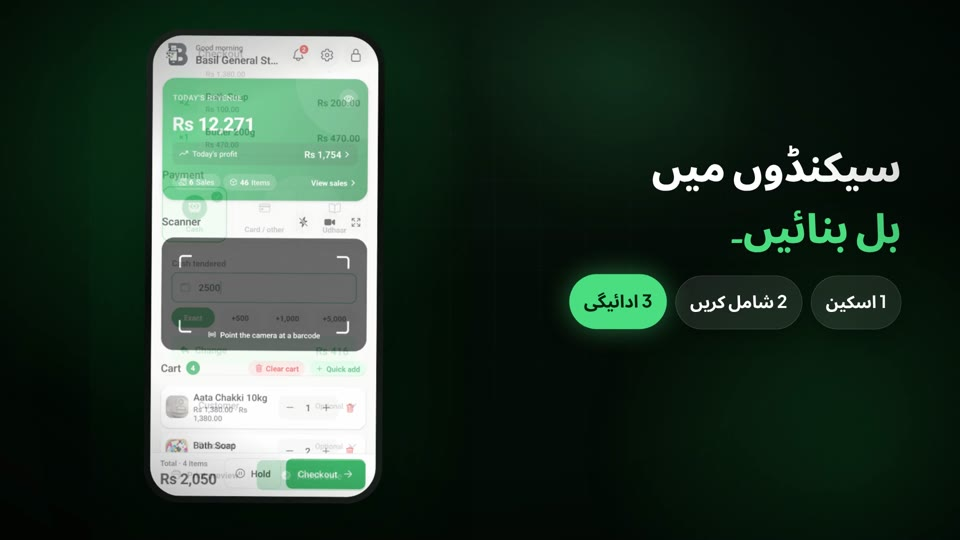](out/BytePOS-Ad-16x9-Urdu.mp4) |
| **9:16** | [](out/BytePOS-Ad-9x16.mp4) | [](out/BytePOS-Ad-9x16-Urdu.mp4) |

**Light theme**

| | English | اردو |
|---|---|---|
| **16:9** | [](out/BytePOS-Ad-16x9-Light.mp4) | [](out/BytePOS-Ad-16x9-Urdu-Light.mp4) |
| **9:16** | [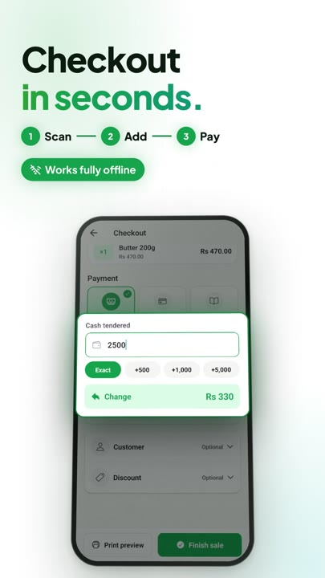](out/BytePOS-Ad-9x16-Light.mp4) | [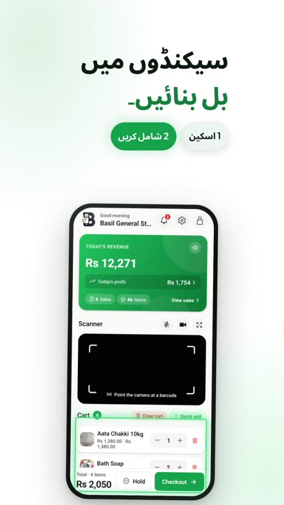](out/BytePOS-Ad-9x16-Urdu-Light.mp4) |

Files are in [`out/`](out) (1920×1080 and 1080×1920, 45 s, with voiceover and music).

### What's in the 45 seconds

| Time | Scene | What you see |
|---|---|---|
| 0–4 s | Hook | "Running a shop never stops." over a moving wall of app screens, with real BytePOS cards flying past |
| 4–9 s | Logo | Logo reveal with light rays, shine and sparks — *Sell smart. Grow fast.* |
| 9–19 s | Checkout | Scan → Add → Pay on the phone: scanner laser, the cart item, payment and change cards pop out of the screen, *Sale complete* |
| 19–26 s | Udhaar ledger | *You'll get* / *You'll give* totals and a customer lift out of the ledger |
| 26–33 s | Profit | Net profit counts up to Rs 1,527 with a drawn chart, phone in front of the Web POS reports |
| 33–40 s | Phone · Web · Computer | Phone, browser and computer fly in one by one, then *One shop, always in sync* |
| 40–45 s | Call to action | *Start free today*, Google Play badge and a scannable QR code |

## Ad images

Three sizes, dark and light, English and Urdu — 12 PNGs in [`out/ads/`](out/ads). Click one for full size.

**Wide (1920×1080)** — website banners, YouTube, Facebook / LinkedIn posts

| | English | اردو |
|---|---|---|
| **Dark** | 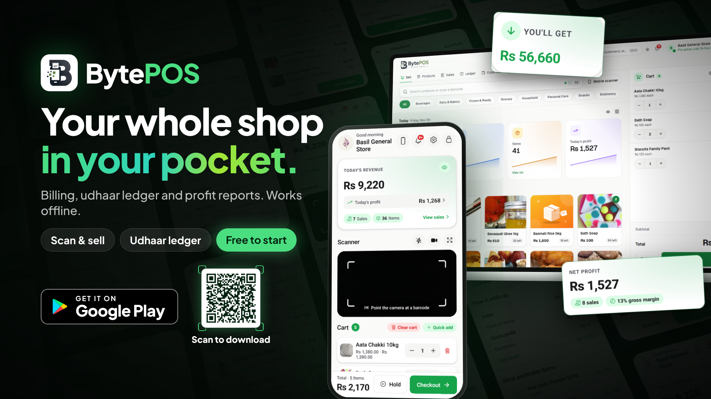 | 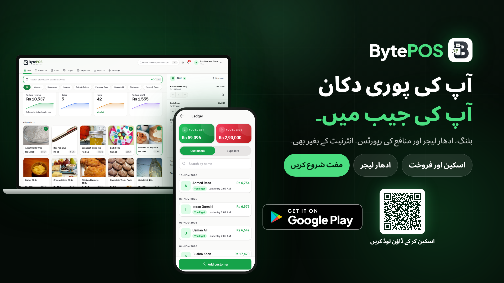 |
| **Light** | 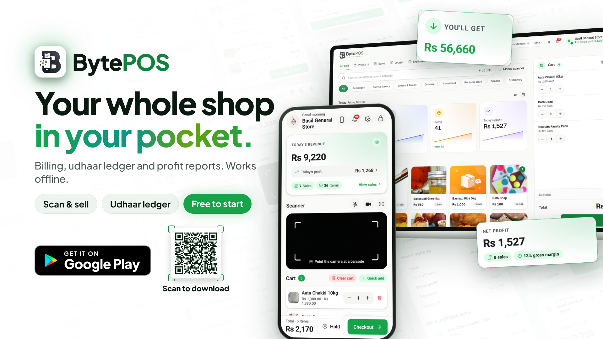 | 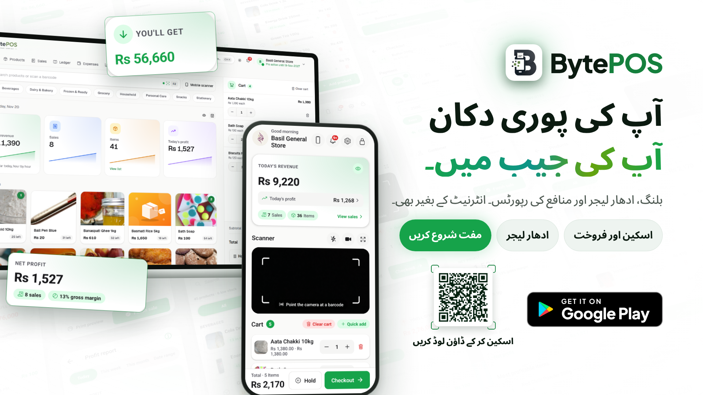 |

**Square (1080×1080)** — Instagram and Facebook feed

| Dark | Dark · اردو | Light | Light · اردو |
|---|---|---|---|
|  | 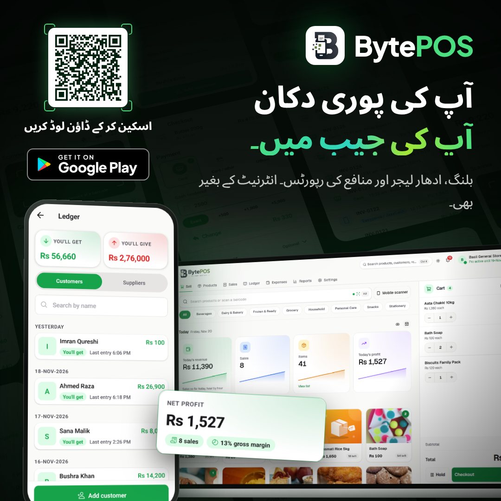 | 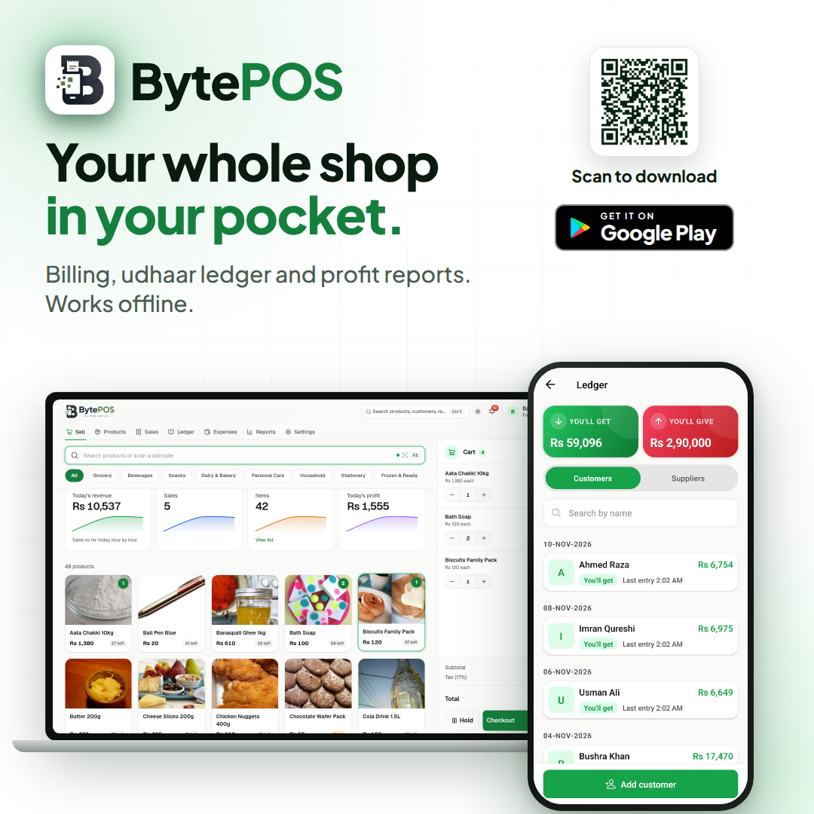 | 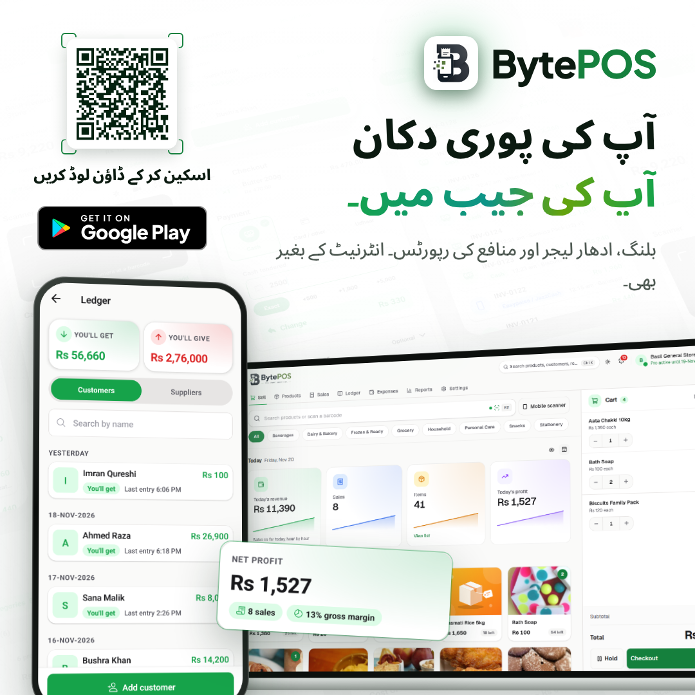 |

**Story (1080×1920)** — WhatsApp status, Instagram / Facebook stories, TikTok

| Dark | Dark · اردو | Light | Light · اردو |
|---|---|---|---|
| 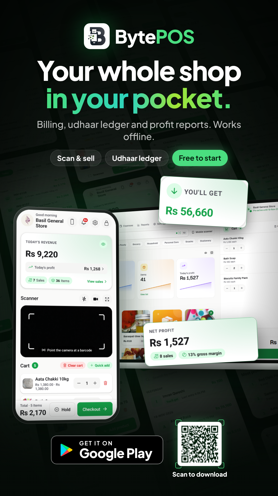 |  | 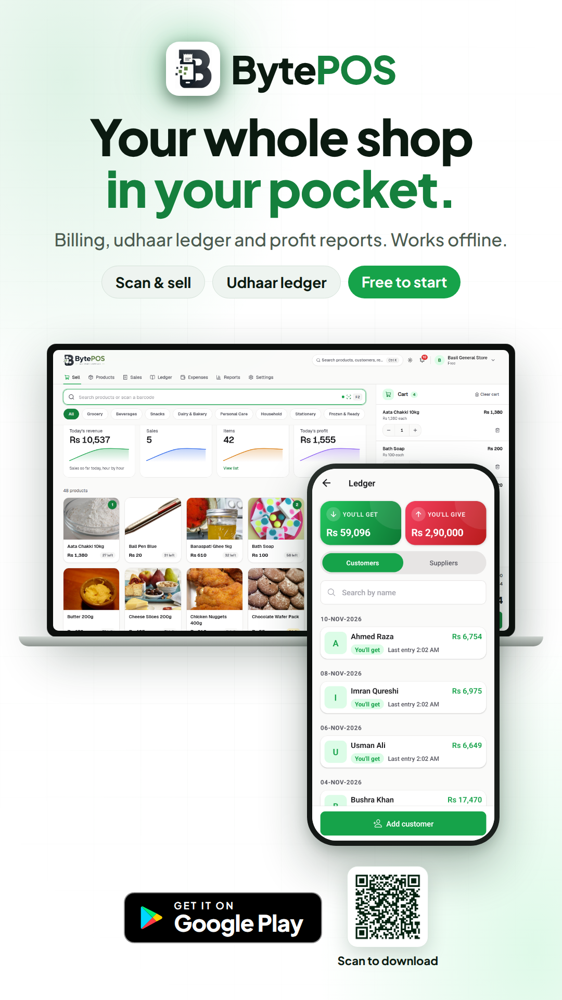 | 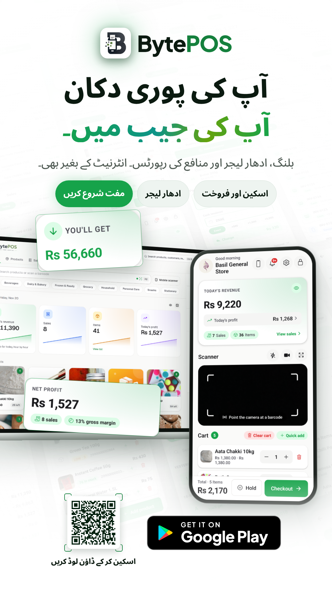 |

## How it was made

- Video and images: [Remotion](https://www.remotion.dev) (React). The whole ad is [`src/Ad.tsx`](src/Ad.tsx) and the images are [`src/AdImage.tsx`](src/AdImage.tsx).
- Screens: real BytePOS screenshots (demo shop data), phone and Web POS, copied from the app's user guide (`bytepos/docs/user-guide/source`). When the app's design changes, copy the new ones into [`public/img/`](public/img) and render again.
- Motion: 3D camera moves on the devices, UI cards cut out of the screenshots that pop out of the phone (`CROPS` in `src/Ad.tsx` holds their pixel boxes), mask-reveal headlines, zoom-through cuts with a light streak, film grain.
- English voiceover: Kokoro, run locally ([`tools/vo.mjs`](tools/vo.mjs)). Urdu voiceover: Microsoft Edge read-aloud Urdu voice ([`tools/vo-ur.mjs`](tools/vo-ur.mjs)).
- Music and sound effects are synthesised in code ([`tools/synth.mjs`](tools/synth.mjs)); no samples or licensed tracks.

## Render it yourself

```bash
npm install
npx remotion studio                                        # preview
npx remotion render BytePOS-Landscape out/BytePOS-Ad-16x9.mp4
npx remotion render BytePOS-Vertical  out/BytePOS-Ad-9x16.mp4
# Urdu: BytePOS-Landscape-UR / BytePOS-Vertical-UR · light theme: add -Light (e.g. BytePOS-Landscape-UR-Light)
npx remotion still AdImage-Wide-Light out/ads/BytePOS-Ad-Wide-Light.png --frame=60
# all 12 images: AdImage-{Square,Wide,Story}-{Dark,Light}[-UR] → out/ads/BytePOS-Ad-{size}-{theme}[-Urdu].png
```

Each video takes about 6 minutes to render.
