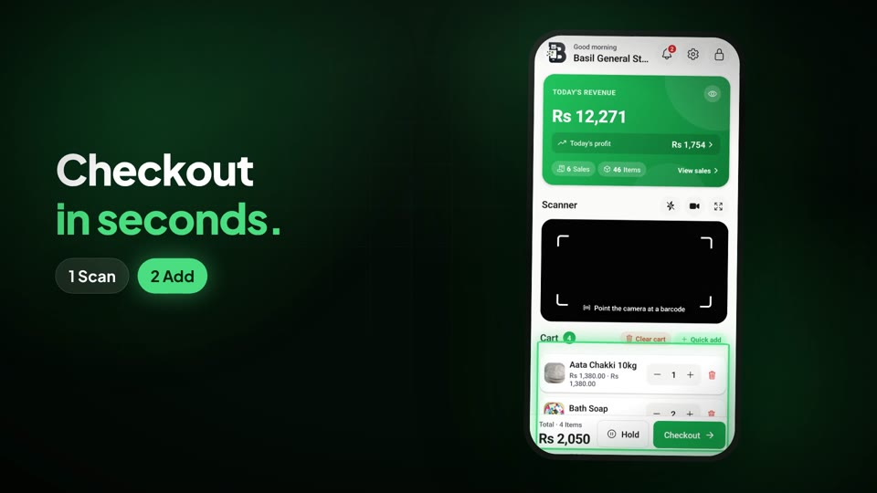
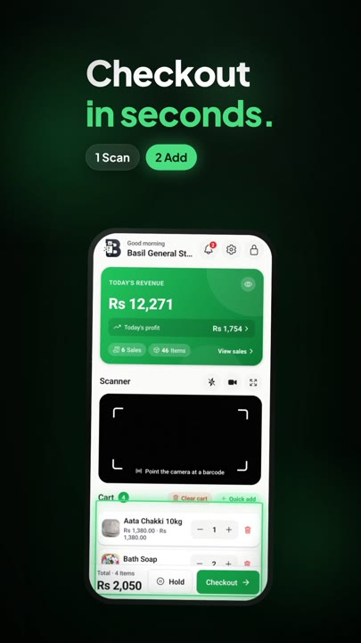
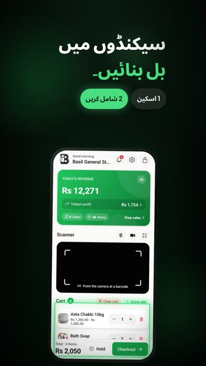
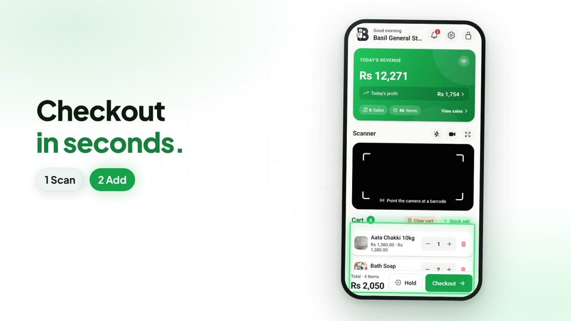
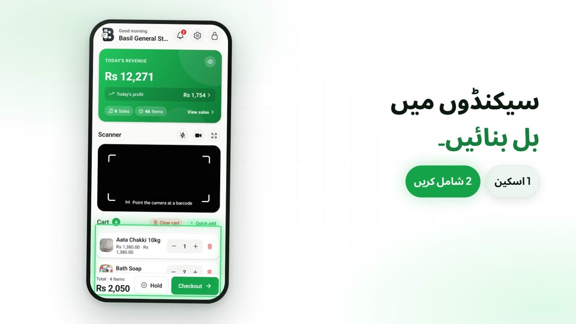
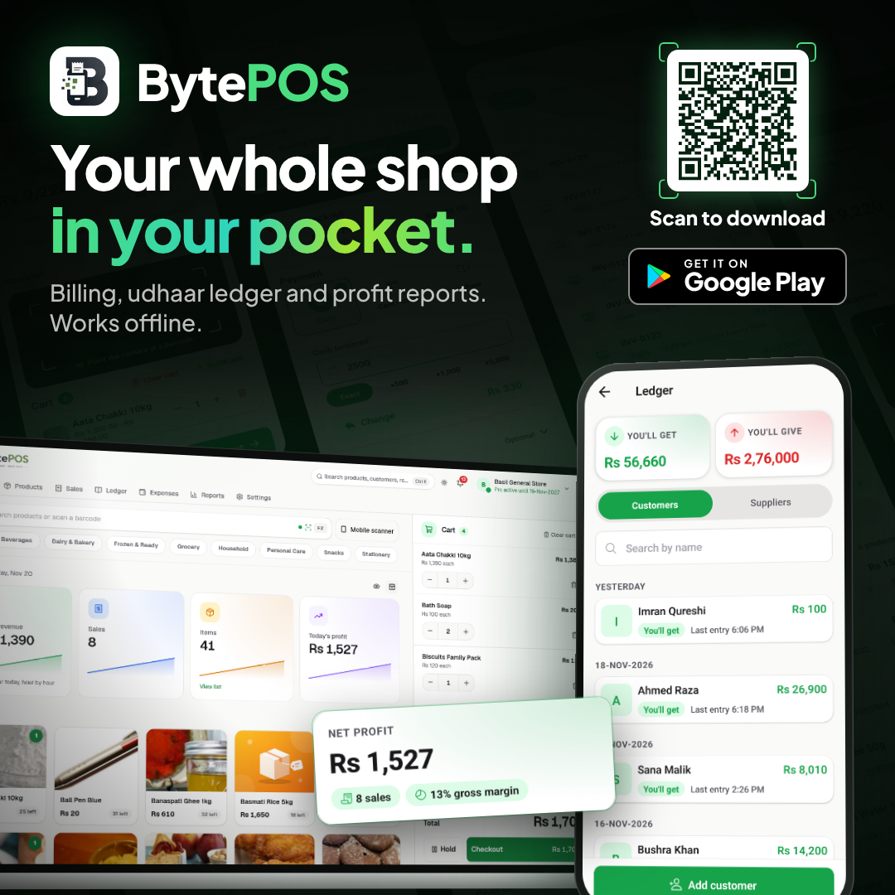
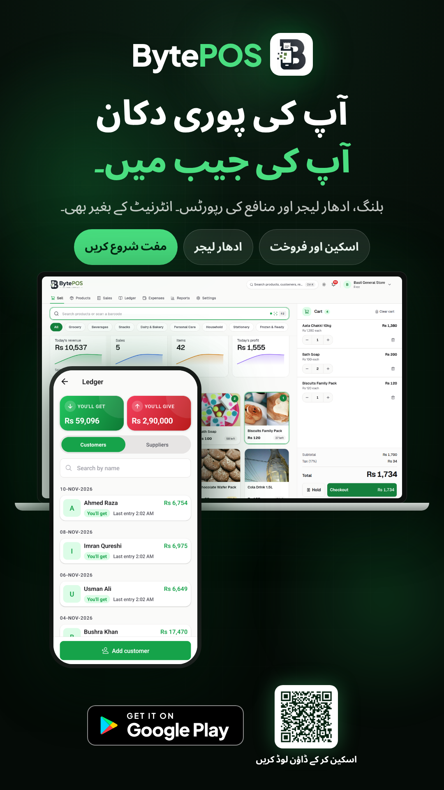

# BytePOS — advertisement

A 45-second commercial and a set of ad images for **BytePOS**, the offline-first POS and billing app for shops.
Built from the app's real screenshots, in English and Urdu, in 16:9 and 9:16.

Get the app: [Google Play](https://play.google.com/store/apps/details?id=com.mafnankhadim.bytepos) · Web app: [bytepos.vercel.app](https://bytepos.vercel.app)

## Videos (click a picture to play)

**Dark theme**

| | English | اردو |
|---|---|---|
| **16:9** | [](out/BytePOS-Ad-16x9.mp4) | [](out/BytePOS-Ad-16x9-Urdu.mp4) |
| **9:16** | [](out/BytePOS-Ad-9x16.mp4) | [](out/BytePOS-Ad-9x16-Urdu.mp4) |

**Light theme**

| | English | اردو |
|---|---|---|
| **16:9** | [](out/BytePOS-Ad-16x9-Light.mp4) | [](out/BytePOS-Ad-16x9-Urdu-Light.mp4) |
| **9:16** | [](out/BytePOS-Ad-9x16-Light.mp4) | [](out/BytePOS-Ad-9x16-Urdu-Light.mp4) |

Files are in [`out/`](out).

## Ad images

Three sizes (square, wide, story), dark and light, English and Urdu — all in [`out/ads/`](out/ads).

<p>
  
  
</p>
<p>
  
  
  
  
</p>

## How it was made

- Video and images: [Remotion](https://www.remotion.dev) (React). The whole ad is [`src/Ad.tsx`](src/Ad.tsx) and the images are [`src/AdImage.tsx`](src/AdImage.tsx).
- Screens: real BytePOS screenshots (demo shop data), phone and Web POS.
- English voiceover: Kokoro, run locally ([`tools/vo.mjs`](tools/vo.mjs)). Urdu voiceover: Microsoft Edge read-aloud Urdu voice ([`tools/vo-ur.mjs`](tools/vo-ur.mjs)).
- Music and sound effects are synthesised in code ([`tools/synth.mjs`](tools/synth.mjs)); no samples or licensed tracks.

## Render it yourself

```bash
npm install
npx remotion studio                                        # preview
npx remotion render BytePOS-Landscape out/BytePOS-Ad-16x9.mp4
npx remotion render BytePOS-Vertical  out/BytePOS-Ad-9x16.mp4
# Urdu: BytePOS-Landscape-UR / BytePOS-Vertical-UR · light theme: add -Light (e.g. BytePOS-Landscape-UR-Light)
npx remotion still AdImage-Wide-Light out/ads/BytePOS-Ad-Wide-Light.png --frame=60
```
